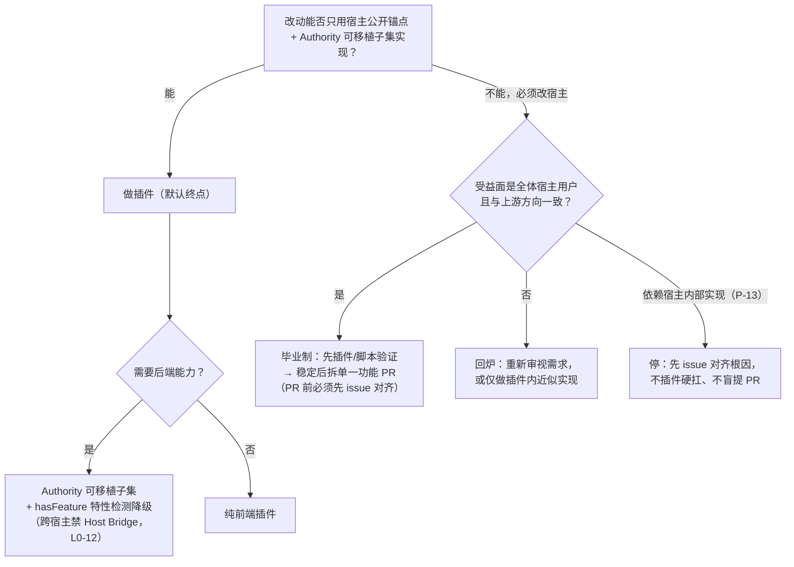

# 01 · 插件 vs 上游 PR：判定准则与逐项清单（R1）

> 任务：`09-22-authority-ecosystem-pr-strategy`（父任务 C-09）
> 回答用户第一问：**哪些要做成插件、哪些可以提 PR 上游？**
> 判定对象取自需求真源 `research/00` §B（B1–B10）与父任务 `design.md` §5.3（L1–L12）。
> 本任务**不提任何 PR**，只出策略（Constraints）。

---

## 一、判定准则

### 1.1 总原则

用户主张（`research/00` §B0）：**「暴露 API，成为一个基础设施；联动打造生态，但又不耦合。」**

翻译为判定公理：

- **A1 宿主归上游，领域归插件**：改动宿主共同行为的 → 提 PR；实现自己领域价值的 → 做插件。
- **A2 基础设施只进一个口**：需要后端能力（持久化/DB/文件/任务/事件/权限）→ 一律走 Authority 可移植子集（见 `04-portable-subset.md`），不自造第二后端。
- **A3 毕业制**：插件是功能的完整交付形态；PR 只是"横切收益的收编"。**任何插件功能都不得依赖 PR 被合入才能工作。**

### 1.2 六维判据

| # | 判据 | → 做插件 | → 提 PR 上游 |
| --- | --- | --- | --- |
| **G1 修改面** | 不改宿主文件，只经公开锚点（公开 API / 事件 / DOM / `plugins/`+`/api/plugins/` 约定）即可实现 | 必须改宿主源码、路由或端点才能实现 |
| **G2 受益面** | 收益属于本插件的领域用户 | 收益是全体宿主用户的横切改进（性能 / bug / 移动端体验 / 安全） |
| **G3 依赖面** | 只依赖公开契约（Authority SDK、宿主事件、DOM 锚点、Companion transaction） | 改动把宿主内部实现"收编"为公开能力，上游愿意背长期兼容责任 |
| **G4 数据面** | 需要服务端持久化等后端能力 → Authority 子集；宿主没有也不该有 | 宿主**已有**该能力，只是缺配置/开关（如备份压缩级别） |
| **G5 通用性** | 个性领域逻辑（聊天分支、可视化、转换器） | 一行级 / 配置级通用改动，diff 可一句话说清 |
| **G6 上游概率** | 无上游信号也必须可用（不上赌桌） | 有 issue 共鸣、与上游设计方向一致、拒收代价≈0 |

### 1.3 判定树

### 1.4 硬门槛（任一不满足即否决）

1. **PR 必须单一功能**（L1-MF-2）：一个 PR 只做一件事，功能边界能一句话说清；禁止捆绑。
2. **插件必须可独立运行**（L0-11）：后端不可用时纯前端路径保持全功能（或明确的功能子集），不阻塞不报错。
3. **跨宿主插件禁 Host Bridge**（L0-12）：只允许依赖可移植子集（`04-portable-subset.md`）。
4. **PR 前先 issue**（P-13 教训）：宿主源码中的内部函数不构成公开契约；提 PR 前必须先在宿主仓 issue 对齐方向与根因，避免"改了内部实现等上游拒绝"。
5. **改动若需同时改 >2 个仓才能交付 → 视为设计问题回炉**（应收敛为插件或契约）。

---

## 二、逐项清单

### 2.1 项目级判定表（需求真源 → 载体）

| 需求项 | 判定 | 落点 / 走向 | 判定理由（判据编号） |
| --- | --- | --- | --- |
| **B1 / L4 st-timeline**（jsonl 屎上雕花，一点不改 jsonl） | **插件** | `jiozhaoyue/SillyTavern-Timelines` fork 仓继续演进 | 不改宿主 G1；个性领域 G2/G5；与 B2 互不替代（需求真源明确） |
| **B2 / L2 chatsys-frontend**（聊天文件归档系统，分支分组/绑定/树状图） | **插件** | 新前端插件；后端能力走 Authority | 大型个性功能，上游无兴趣 G2/G5；数据面 G4 → Authority（B3） |
| **B3 / L3 chatsys-backend**（通用后端） | **不自造** | **直接用 Authority 可移植子集**；跨插件共享经 Companion Modules transaction 暴露 | "通用后端"已存在 = Authority（G4/A2）；自造 = 生态分裂 + 维护地狱。详见 `03-backend-route.md` |
| **B4 / L5 shujuku-rebuild**（前端极限 + 后端转交） | **插件**（含 Authority 转交） | 前端插件做到能力极限；`hasFeature('sql.private')` 检测到 Authority 后把不该前端做的转交后端 | 用户已裁定此模式（`research/00` §B4）；纯前端可全功能降级 G4/L0-11 |
| **B5 / L6 zip-converter**（导入 408 / 云 CF 100MB / 流量优化 / tt↔pt↔st 兼容） | **插件为主 + 1 条候选 PR** | 导入器、浅层化、多包后台导入、平台兼容 = 插件；**导入 408 若定位为宿主端点 bug → 先 issue 后候选 PR** | 主体个性 G5；408 属宿主端点行为 G1/G2，但根因未查，禁止盲提（G6 + P-13） |
| **B6 / L7 隐藏助手二开** | **插件** | 酒馆助手脚本 | 领域个性 |
| **B7 / L8 酒馆美化**（仿 agent desktop） | **插件** | 纯前端（CSS 双前缀，L0-10） | 领域个性 |
| **B8.1 / L9 脚本一键导入导出** | **插件** | 酒馆助手脚本 | 领域个性 |
| **B8.2 智能深色模式** | **候选 PR + 插件兜底** | 若宿主主题体系支持"跟随系统"开关 → issue→PR；否则插件自实现 | 横切体验 G2，但上游接受度未知 G6 → 先 issue 探路 |
| **B9 / L10 ST-copilot**（侧边栏/多实例/分屏） | **插件** | 前端插件 | 大型个性功能 G2/G5 |
| **B10.1 / L11-① 数据库设置完全遮罩 + 手势回退防护** | **PR（Luker 优先，ST 同步评估）** | 宿主移动端 UI/导航行为；插件难以"完全遮住宿主导航 + 强制屏蔽侧拉回退"（G1） | 移动端横切体验 G2；已在 `research/00` §B10 定性为宿主改造，走 Dev/Luker 仓验证后提 |
| **B10.2 / L11-② 拖拽预设 + 智能分类** | **插件验证 → PR 收编（毕业制）** | 预设管理是宿主界面（G1）；先插件形态证需求，稳定后拆 PR | 毕业制 A3；智能分类逻辑若被拒可长期留在插件，不影响宿主 |
| **B10.2附 备份 zipLevel（`store:true` / `backups.zipLevel` 配置化）** | **PR（最高优先）** | 一行级 + config 项 + 文档，Luker 与 ST 各提一条（单一功能） | 教科书级命中 G1/G2/G5/G6；`research/00` §B10 已附具体改法；收益最大、争议最小 |
| **B10.3 / L11-③ 扩展页懒扫描**（记录上次扫描 + 缓存 + 手动扫描） | **PR（次优先）** | 宿主扩展页性能优化 | 横切性能 G2/G5；可先以用户脚本/插件验证收益再提 |
| **B10.4 luker 多 agent 查看 + `request_user_input for sillytavern`** | **调研 → 后定** | 先完成 Luker 多 agent 机制调研再判定载体 | 素材不足，禁止拍板（L0-5） |
| **L1–L3 / L5–L10** | 同 B1–B9 | — | 与上表一一对应 |
| **L12 插件注册表 / 统一调控台** | **Authority 侧新能力（立项，见下）** | 本仓 `packages/server-plugin` + Security Center | 不是插件也不是宿主 PR，是基础设施自身演进 |

### 2.2 汇总口径

- **插件主线 9 条**：B1/B2/B4/B5/B6/B7/B8/B9 + chatsys 后端集成（经 Authority）。
- **PR 池 5 + 1 条**（全部先 issue 后 PR，从 `origin` 分支发起，绝不 push upstream，L1-MF-1）：
  1. backups `zipLevel` 配置化（Luker + ST 各一条）——最高优先
  2. 扩展页懒扫描缓存（Luker 先，ST 跟进）
  3. 移动端数据库设置遮罩 + 手势回退防护（Luker 先）
  4. 拖拽预设（插件毕业后收编）
  5. 智能深色模式跟随系统（候选，issue 探路）
  6. （候选）导入端点 408 修复——须先 issue 定位根因
- **PR 目标宿主**：**ST（上游根，合入后 fork 群自然受益）与 Luker（fork 特有/云移动端诉求）**。
  **PT / TT 暂不作为 PR 目标**——fork 偏离大且无服务端插件基建（`research/07` §2.5），投入产出不成立。
- **Luker 侧急用与上游时差的处理**：L11 三件套先在 `Instance/Dev/Luker` 对应 fork 仓交付自用（`research/00` §B10 已注明"宿主源码改造方案另行走 Dev/Luker 仓库交付"）；ST 侧合入后 Luker rebase 自然获得，避免长期私有分叉。

---

## 三、L12（插件注册表 / 统一调控台）立项建议

> 回应父任务 `design.md` §5.3 L12 与 `research/10` §B.3。

**明确建议：立项，MVP 缩范围为「只读注册表」，优先级 P1。**

### 3.1 为什么立项

- **缺口是真实的**（`research/10` §B.3）：Authority 已有四层**能力治理**原语（权限隔离 / Feature Flags / Companion Modules / Agent 工具注册），但**缺**：插件清单、依赖与兼容矩阵、健康与冲突检测、跨宿主可用性登记。
- **人工登记会腐烂**：本次 C-08 的四宿主可用性结论是人工静态验证；不做机制化，跨宿主可用性约束（L0-12）只能靠人记，违反风险随插件数量线性上升。
- **本仓正是迭代主场**：Authority fork 已确定大量迭代（D4 裁定），注册表是给 B2/B4/B5 多条插件上线铺路的地基。

### 3.2 MVP 范围（只读，不新造机制）

| # | 能力 | 依据（复用现有机制） |
| --- | --- | --- |
| 1 | **插件清单**：装了哪些、各版本、声明权限、所在宿主 | `module-discovery-service` 已能发现 `.authority/module.json`；SDK 有 manifest → 聚合即可，不新造发现机制 |
| 2 | **跨宿主可用性登记**：每个插件标注四宿主可用性（机制化 C-08 的人工结论） | 静态登记数据 + `04-portable-subset.md` 的子集口径 |
| 3 | **依赖矩阵**：谁通过 `client.tx('<moduleId>:<txName>')` 调谁的哪个 transaction | 从 Companion 声明静态提取，无需运行时观测 |

### 3.3 明确推后（不进 MVP）

- **运行时冲突检测**（两个插件 hook 同一事件 / 改同一 DOM）：需要运行时观测与归因，产品级投入，先让只读数据产生价值。
- **自动安装 / 升级调控**：与宿主原生扩展安装器职责重叠，违反"并存非替代"边界（`research/04` §6.3）。

### 3.4 落点与流程

- 落点：本仓 `packages/server-plugin` 新增公开只读路由 `GET /api/plugins/authority/registry/*` + SDK client 方法 + Security Center 新版块。
- **必须走 L1-MF-8 八步顺序**：`shared-types` DTO → core 能力 → `CoreService` 代理 → server service/route → SDK client → 文档/Security Center → 基准（只读聚合非性能敏感，可免 `bench:core`，仍须说明）→ 测试与 installable 同步。
- 只读路由仍须过 `PermissionService` 权限声明（L1-MF-9 ②），扩展需显式声明后才能读注册表。

---

## 四、证据来源

| 来源 | 用途 |
| --- | --- |
| `research/00-requirements-inventory.md` §B0–B12 | 需求真源（判定对象、B10 宿主改造附注） |
| `../09-21-multi-repo-rules-skills-survey/design.md` §5.3 | L1–L12 业务线登记 |
| `research/04-plugin-authority.md` §3.2、§6.1–6.3 | Authority 命名空间、接入硬约定、并存非替代 |
| `research/07-authority-host-compat-verification.md` §2.5、§3.1 | PT/TT 无服务端基建；四宿主可用性推论 |
| `research/10-trellis-integration-and-plugin-governance.md` §B | 四层治理原语与注册表缺口（L12 依据） |
| 仓群统一规则 `AGENTS.md` L1-MF-1/2、L0-11/12 | PR 纪律、插件独立运行、Host Bridge 禁令 |
