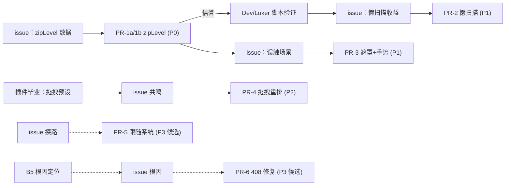

# 02 · PR 拆分方案（R2）

> 任务：`09-22-authority-ecosystem-pr-strategy`（父任务 C-09）
> 回答用户第二问：**改了这么多，怎么逐个提 PR（功能单一、可 review）？**
> 本任务**只出拆分方案，不实际提 PR**（Constraints）；实际提请另开任务逐条执行。

---

## 一、拆分总纲（五条纪律）

1. **单一功能铁律**（L1-MF-2）：一个 PR 只做一件事，功能边界能用**一句话**说清；说不清 = 拆分未完成。
2. **先 issue 后 PR**（P-13 教训）：宿主内部实现不是公开契约；每个 PR 提出前必须先在目标宿主仓开 issue 对齐方向/根因，附数据与复现。
3. **分支与寿命模型**（L1-MF-1 / L0-7）：`git fetch upstream` 后用 `--ff-only` 对齐；从 `upstream/main` 切短分支 `pr/<host>/<scope>-<thing>`，**推送只到 `origin`**，经 GitHub 界面向 upstream 发起 PR；合并或拒收后**删除分支**。分叉寿命 = PR 生命周期，禁止长期私有分叉。
4. **信誉阶梯**：先提最小、无争议、可独立验证的（PR-1），用小 PR 建立可信度后再提中等的。
5. **毕业制**（`01` 号文 A3）：中大型宿主改动先以插件/用户脚本形态验证需求与收益，稳定后才拆 PR；**插件功能不依赖 PR 被合入**。

---

## 二、PR 台账（逐条：单一功能边界 / 依赖 / 验收点）

> 优先级：P0 立即可发（issue 后）｜P1 需先插件/脚本验证｜P2 毕业后｜P3 候选（issue 探路后再定）。
> 「目标宿主」为 ST = `SillyTavern/SillyTavern`，L = Luker 上游；两条宿主各提的记作 a/b。

### PR-1a / PR-1b：备份 zip 级别配置化 `backups.zipLevel`

| 项 | 内容 |
| --- | --- |
| **一句话边界** | 把备份归档的压缩级别从硬编码 `deflate-6` 改为可配置 `backups.zipLevel`（0–9），默认值维持上游现状不变 |
| **包含** | `src/users.js` `createBackupArchive` 内 `archiver('zip', { zlib: { level: getConfigValue('backups.zipLevel', 6) } })`（改法已附于 `research/00` §B10.2附）；`default/config.yaml` 注释文档；（有测试基建则）断言 `level=0` 时走 store |
| **不包含** | 任何备份调度、路径、加密行为改动；**不擅自改上游默认压缩级别**（默认不变 = 零行为变更，可收性最高；想用 store 的用户自行配 0） |
| **依赖** | 无（首发信誉 PR） |
| **验收点（可 review）** | ① diff 仅 `src/users.js` ±3 行 + config 注释；② issue 附实测数据（`level=6` vs `level=0` 的 TTFB/体积对比，`research/00` 已有分析）；③ 默认值下行为与上游逐字节一致 |
| **规模** | S（约 5 行） |
| **优先级 / 宿主** | **P0**；PR-1a → ST，PR-1b → L |

### PR-2：扩展页懒扫描（扫描缓存 + 手动刷新）

| 项 | 内容 |
| --- | --- |
| **一句话边界** | 扩展页不再每次进入都全量扫描：记录上次扫描时间，阈值内直接用缓存 URL 列表，提供手动扫描入口 |
| **包含** | 扩展列表扫描的缓存层（上次扫描时间戳 + 阈值判断 + 手动刷新按钮）；命中缓存时不发网络请求 |
| **不包含** | 扩展安装 / 更新 / 启停逻辑的任何改动；UI 改版 |
| **依赖** | 无强依赖；建议在 PR-1 合并或获正面反馈后提交（信誉阶梯） |
| **验收点** | ① 重复进入扩展页无重复网络扫描（network 面板取证）；② 手动扫描按钮即时生效；③ issue 附收益数据（进页耗时前后对比）；④ 缓存失效场景（安装/卸载扩展后）行为正确 |
| **规模** | M |
| **优先级 / 宿主** | **P1**；先以用户脚本在 `Instance/Dev/Luker` 验证收益（毕业制，只读脚本不改实例数据），再提 PR-2a（L）→ PR-2b（ST） |

### PR-3：移动端数据库设置遮罩 + 手势回退防护

| 项 | 内容 |
| --- | --- |
| **一句话边界** | 数据库设置面板打开时全屏遮罩聊天界面，并强制屏蔽侧拉回退手势，防止移动端误触回退至临时聊天界面 |
| **包含** | 设置面板的遮罩层与手势拦截（触达宿主导航/手势处理逻辑，G1 判定必须改宿主） |
| **不包含** | 数据库设置面板功能本身的任何改动 |
| **依赖** | 无强依赖；与 PR-2 可并行 |
| **验收点** | ① 移动端录屏：打开设置后聊天界面不可交互；② 侧拉手势被拦截不回退临时聊天；③ 桌面端行为零变化（回归）；④ issue 附误触场景描述 |
| **规模** | M |
| **优先级 / 宿主** | **P1**；PR-3a → L 优先（云/移动是主战场，`research/00` §B10 原始诉求），PR-3b → ST 评估同题是否存在 |

### PR-4：预设列表拖拽重排（毕业后收编）

| 项 | 内容 |
| --- | --- |
| **一句话边界** | 预设管理列表支持拖拽排序并持久化顺序 |
| **包含** | 拖拽交互 + 顺序持久化 |
| **不包含** | **智能分类**（需求真源中与拖拽并列的功能）——拆为后续独立 PR 或长期留在插件，绝不捆绑（L1-MF-2） |
| **依赖** | 插件形态验证完成 + issue 获上游共鸣（毕业制） |
| **验收点** | ① 拖拽后顺序持久化（刷新/重启不丢）；② 拖拽过程不误触点击；③ 与上游现有列表交互风格一致 |
| **规模** | M |
| **优先级 / 宿主** | **P2**；PR-4a（L）→ PR-4b（ST，视 ST 预设界面同构性） |

### PR-5（候选）：主题「跟随系统」智能深色模式

| 项 | 内容 |
| --- | --- |
| **一句话边界** | 主题设置增加「跟随系统」选项，宿主按 `prefers-color-scheme` 切换 |
| **依赖** | **issue 探路结果**（上游是否认为该属主题系统职责，G6） |
| **验收点** | 系统深浅色切换即时生效；手动选择模式不受影响 |
| **优先级 / 宿主** | **P3**；可能不发（若上游拒）→ 智能深色模式以插件自实现兜底 |

### PR-6（候选）：导入端点 408 修复

| 项 | 内容 |
| --- | --- |
| **一句话边界** | 仅当 B5 插件开发中把 408 定位为**宿主端点超时行为 bug** 时，提最小修复 |
| **依赖** | B5 插件开发中的根因定位 + issue 对齐（禁止盲提，P-13） |
| **验收点** | issue 内有复现、根因、修复；大文件导入不再 408 |
| **优先级 / 宿主** | **P3**；ST/L 视根因归属 |

---

## 三、依赖顺序

- **并行性**：PR-2 与 PR-3 互不依赖，可并行推进；其余按图序。
- **与插件线的耦合**：只有 PR-4 / PR-6 依赖插件线进度，PR-1/2/3/5 可独立启动。

---

## 四、双宿主（ST × Luker）提交策略

| 场景 | 策略 |
| --- | --- |
| 同一改动两边都受益（zipLevel、懒扫描） | **先提 ST**（上游根）；合入后 Luker `rebase` 自然继承；Luker 侧若急用 → 先在 Dev/Luker 对应 fork 仓自带补丁自用（L11 交付口径），ST 合入后**删除私有补丁** |
| Luker 特有诉求（多 agent、云/移动交互、遮罩手势） | **直接提 Luker**，不强行对 ST 泛化 |
| PT / TT | **不作为 PR 目标**（fork 偏离大、无服务端插件基建，`research/07` §2.5） |
| 红线 | 绝不 `git push upstream`；拉取只用 `--ff-only`；不用 `reset --hard` 排障（L0-7 / L1-MF-1） |

---

## 五、验收总表（可执行性检查）

| PR | 一句话边界 | 目标宿主 | 依赖 | 优先级 | 独立可 review 验收 |
| --- | --- | --- | --- | --- | --- |
| PR-1a/1b | zipLevel 配置化（默认不变） | ST / L | 无 | P0 | ✅ diff ±3 行 + 实测数据 |
| PR-2 | 扩展页扫描缓存 + 手动刷新 | L→ST | 脚本验证 | P1 | ✅ network 取证 + 收益数据 |
| PR-3 | 设置遮罩 + 手势拦截 | L→ST | 无 | P1 | ✅ 移动端录屏 + 桌面零回归 |
| PR-4 | 拖拽重排（不含分类） | L→ST | 插件毕业 | P2 | ✅ 持久化 + 误触为零 |
| PR-5 | 跟随系统主题 | ST→L | issue 探路 | P3 | ✅ 即时切换 + 手动模式不回归 |
| PR-6 | 端点 408 修复 | 视根因 | B5 定位 | P3 | ✅ 复现/根因/修复齐备 |

**每条 PR 的通用 review 清单**：功能单一句成立；diff 集中单一模块；无新依赖（或说明理由）；无关文件零改动；测试或可复现步骤齐备；风格/i18n 贴合上游惯例。

---

## 六、明确不做

- 不把**多包后台导入、平台兼容、浅层化**等插件领域功能塞进任何 PR（`01` 号文判定表）。
- 不提任何捆绑式「大而全」PR。
- 不在 PR 被拒后将补丁长期背在 fork 上（拒收预案见 `05-maintenance-cost.md` §3）。
- 本任务不实际发起任何 PR（Constraints，提请另开任务）。

---

## 证据来源

| 来源 | 用途 |
| --- | --- |
| `research/00` §B10（含 zipLevel 具体改法与"另行走 Dev/Luker 仓交付"注记） | PR-1/2/3/4 的需求真源 |
| `research/00` §B5 | PR-6 候选依据（408 / CF 100MB 诉求） |
| 仓群统一规则 L1-MF-1/2、L0-7 | 分支模型、单一功能、推送红线 |
| `01-plugin-vs-pr-criteria.md` §1.4 | 先 issue 后 PR、毕业制硬门槛 |
